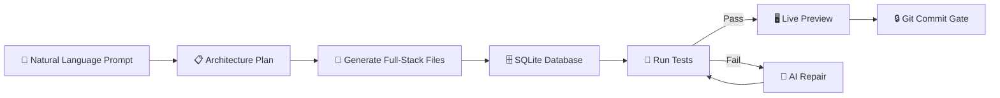
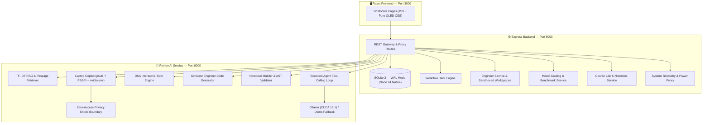

<div align="center">

<!-- ═══════════════════════════════════════════════════════════════════════ -->
<!-- ORBIT AI — README                                                      -->
<!-- ═══════════════════════════════════════════════════════════════════════ -->

<br>

<picture>
  <source media="(prefers-color-scheme: dark)" srcset="https://img.shields.io/badge/🪐_ORBIT_AI-Local_AI_Engineering_Workspace-blueviolet?style=for-the-badge&labelColor=0d1117&color=6f42c1">
  
</picture>

### *Your Personal AI-Powered Coding Studio — 100% Free, 100% Local, Zero Cloud APIs*

<br>

[](https://nodejs.org/)
[](https://python.org/)
[](https://react.dev/)
[](https://fastapi.tiangolo.com/)
[](https://www.sqlite.org/)
[](https://ollama.com/)
[](https://www.docker.com/)
[](LICENSE)
[](#-test-results)

<br>

> **ORBIT AI** is a full-stack, local-first AI engineering workstation designed for **computer science students** and **developers**. It combines a document-grounded knowledge hub, an autonomous AI software engineer, an interactive DSA tutor, a model testing lab, an autonomous laptop copilot with zero-access privacy shield, and a course-to-code notebook generator — all running on your own laptop with **zero paid subscriptions**.

<br>

[**🚀 Get Started in 2 Minutes**](#-get-started-in-2-minutes) &nbsp;•&nbsp;
[**✨ Features**](#-what-can-orbit-ai-do) &nbsp;•&nbsp;
[**🏗️ Architecture**](#%EF%B8%8F-architecture) &nbsp;•&nbsp;
[**🧪 Tests**](#-test-results) &nbsp;•&nbsp;
[**📖 FAQ**](#-frequently-asked-questions)

---

</div>

<br>

## 🚀 Get Started in 2 Minutes

> **Works on any Windows laptop — no GPU required, no cloud account needed.**

### Step 0 — Install Prerequisites

You need two things installed. If you already have them, skip ahead.

| Tool | Version | Download Link | How to Check |
| :--- | :--- | :--- | :--- |
| **Node.js** | v18 or newer (v22 LTS recommended) | [nodejs.org/en/download](https://nodejs.org/en/download/) | `node --version` |
| **Python** | v3.11 or newer | [python.org/downloads](https://www.python.org/downloads/) | `python --version` |

> [!TIP]
> **Optional but recommended:** Install [**Ollama**](https://ollama.com/download) for real local AI model inference, and [**Docker Desktop**](https://www.docker.com/products/docker-desktop/) for sandboxed code execution. ORBIT AI works perfectly without them in **Demo Mode**.

<br>

### Step 1 — Clone the Repository

Open **PowerShell** or **Terminal** and run:

```powershell
git clone https://github.com/omkhade75/prototype.git
cd prototype
```

<br>

### Step 2 — Install Dependencies

Run these three commands (one time only):

```powershell
# Install Python AI service dependencies
cd ai-service
pip install -r requirements.txt
cd ..

# Install Node.js backend dependencies
cd backend
npm install
cd ..

# Install React frontend dependencies
cd frontend
npm install
cd ..
```

<details>
<summary><strong>💡 Shortcut — copy-paste all at once</strong></summary>

```powershell
cd ai-service; pip install -r requirements.txt; cd ..; cd backend; npm install; cd ..; cd frontend; npm install; cd ..
```

</details>

<br>

### Step 3 — Launch ORBIT AI 🚀

```powershell
powershell -ExecutionPolicy Bypass -File .\launch-orbit.ps1
```

**That's it!** The launcher will:

1. ✅ Detect your Python and Node.js installations
2. ✅ Check if Ollama and Docker are running (optional)
3. ✅ Verify ports 3000, 5000, and 8000 are free
4. ✅ Start all three services automatically
5. ✅ Wait for health checks to pass
6. ✅ **Open your browser** to the app

<br>

### 🌐 Your Local URLs

Once launched, access ORBIT AI at:

| Service | URL | What It Does |
| :--- | :--- | :--- |
| 🖥️ **Frontend App** | **[http://localhost:3000](http://localhost:3000)** | The main ORBIT AI interface |
| ⚙️ **Backend API** | [http://localhost:5000/api/health](http://localhost:5000/api/health) | Express REST API & health status |
| 🤖 **AI Service Docs** | [http://localhost:8000/docs](http://localhost:8000/docs) | FastAPI interactive API docs |

<br>

### Step 4 — Stop ORBIT AI

When you're done, cleanly shut down all services:

```powershell
powershell -ExecutionPolicy Bypass -File .\stop-orbit.ps1
```

<br>

<details>
<summary><strong>🔧 Alternative: Manual 3-Terminal Startup</strong></summary>

If you prefer launching each service in its own terminal window:

| Terminal | Command | Port |
| :--- | :--- | :--- |
| **Terminal 1** — AI Service | `powershell -ExecutionPolicy Bypass -File .\start-ai-service.ps1` | `:8000` |
| **Terminal 2** — Backend | `powershell -ExecutionPolicy Bypass -File .\start-backend.ps1` | `:5000` |
| **Terminal 3** — Frontend | `powershell -ExecutionPolicy Bypass -File .\start-frontend.ps1` | `:3000` |

</details>

<br>

<details>
<summary><strong>🐧 Running on macOS / Linux?</strong></summary>

The launcher scripts are written for PowerShell on Windows. On macOS or Linux, start each service manually:

```bash
# Terminal 1 — Python AI Service
cd ai-service && python -m uvicorn app.main:app --host 127.0.0.1 --port 8000

# Terminal 2 — Node.js Backend
cd backend && npm start

# Terminal 3 — React Frontend
cd frontend && npm run dev
```

Then open [http://localhost:3000](http://localhost:3000) in your browser.

</details>

---

<br>

## ✨ What Can ORBIT AI Do?

ORBIT AI is built around **12 integrated modules**. Here's what each one does:

<br>

### 🏠 Home — System Dashboard

The landing page shows a **live readiness checklist** that pings all three microservices and reports real-time status for:
- ✅ Express backend API
- ✅ SQLite database engine
- ✅ Python AI microservice
- ✅ Docker sandbox availability

Quick-launch cards guide you to any module.

<br>

### 📖 Start Here — User Guide

An interactive onboarding guide that explains:
- What ORBIT AI does and who it's for
- How each module works
- How to set up Ollama for local AI
- Troubleshooting common issues

> [!NOTE]
> **First time?** Start here. It walks you through everything step by step.

<br>

### 💻 Autonomous Laptop Copilot & Zero-Access Privacy Shield

A hardware-aware system control engine and privacy boundary designed specifically for developer laptops (calibrated for modern hardware like Intel Core i7-13620H & NVIDIA RTX 3050 6GB):

- **Real-Time Hardware Telemetry** — Live multi-core CPU load %, RAM utilization & free GB, battery charge status, C: drive SSD capacity, and direct NVIDIA GPU telemetry (`nvidia-smi`) tracking GPU temperature (°C), wattage draw, and VRAM consumption.
- **Intelligent Load Shifting & CPU Cooling** — Dynamic process priority management via `psutil`. Automatically demotes heavy background tasks (cloud synchronization engines, background updaters) to `BELOW_NORMAL_PRIORITY_CLASS`, relieving thermal stress on CPU cores.
- **PSAPI Memory Working Set Trimming** — Directly invokes Windows kernel `ctypes.windll.psapi.EmptyWorkingSet` across inactive processes, instantly recovering cached physical memory pages and reclaiming RAM.
- **Network & DNS Acceleration** — Automates Windows DNS resolver cache flushing (`ipconfig /flushdns`) and benchmarks low-level TCP socket round-trip latency against Cloudflare (`1.1.1.1:53`) and Google (`8.8.8.8:53`) with active connection counting.
- **Zero-Access Privacy Shield** — A strict, hardcoded security barrier enforced in the Python system controller. Permanently blocks local AI models from reading, writing, indexing, or touching sensitive user directories (`Documents`, `Pictures`, `Desktop`, `Downloads`, `.ssh`, `.aws`, browser credential databases, and private encryption keys).
- **In-Browser Terminal Copilot** — Interactive conversational terminal powered by local Ollama (`qwen3.5:4b`) or offline deterministic fallback. Accepts natural commands such as *"shutdown in 15 min"*, *"boost performance & shift load"*, *"flush dns"*, and *"system status"*.
- **System Power Scheduling** — One-click safe shutdown scheduler with visual countdown and abort capability, machine restart, and instant workstation locking (`LockWorkStation`).
- **Pure OLED Pitch-Black UI Standard** — Precision-tuned `#000000` deep OLED theme with zero blue/navy tint and no continuous CSS compositor repaints (`auroraMeshMove` removed), maintaining near-zero idle GPU usage and keeping laptop fans silent (<48°C idle).

<br>

### 📚 Knowledge Hub — Document RAG

Upload PDFs, text files, or markdown and ask questions grounded in your documents.

| Feature | How It Works |
| :--- | :--- |
| **Ingestion** | Upload `.pdf`, `.txt`, `.md` files (up to 10 MB) |
| **Chunking** | Sliding-window chunker (500 chars, 100-char overlap) |
| **Retrieval** | Pure-Python **TF-IDF + Cosine Similarity** — no cloud embeddings |
| **Answers** | Grounded in retrieved passages with citations (Document, Page, Chunk ID, Score) |

<br>

### 🤖 Agent Playground — AI Tool Calling

Talk to a bounded AI agent that can use registered tools:
- `search_knowledge_base` — queries your uploaded documents
- `summarize_document` — generates extractive summaries
- `generate_quiz` — creates multiple-choice quizzes from content
- `structured_result` — outputs formatted JSON analysis

Full step-by-step **execution trace** with timing, inputs, and tool outputs visible in the UI.

<br>

### 💻 Coding Playground & DSA Tutor

An interactive programming environment for learning Data Structures & Algorithms:

- **Languages:** C++ 17 and Python 3.11 with idiomatic templates
- **4 Modes:**
  - **Learn** — Deep concept explanations with memory layouts and edge cases
  - **Build With Me** — Scaffolded problem solving with progressive hints
  - **Debug** — Automated diagnosis of syntax errors, off-by-one bugs, segfaults
  - **Practice** — Real LeetCode problems with constraints and test cases
- **10 DSA Topics:** Arrays, Strings, Hashing, Linked Lists, Stacks, Queues, Binary Search, Trees, Graphs, Dynamic Programming
- **Structured Output:** Problem analysis → approach comparison → pseudocode → solution → line-by-line walkthrough → dry-run trace → complexity analysis

<br>

### 🔨 Software Engineer Agent

An **autonomous AI development agent** that turns a natural-language prompt into a real, runnable full-stack project:

```
"Build a restaurant management system with menu items, orders, and daily revenue tracking"
```

↓ ORBIT AI will:

1. **Plan** the architecture (database schema, API routes, frontend pages)
2. **Generate** real files — HTML, CSS, JavaScript, Express routes, SQLite schema
3. **Create** a genuine binary SQLite database (`.db` file with real tables)
4. **Run** automated tests in a sandboxed environment
5. **Start** a live development preview on a local port
6. **Screen** for secrets before any Git commit

> [!IMPORTANT]
> This is a real code generator, not a chatbot that returns snippets. It creates actual project directories with working databases, routes, and test suites.



<br>

### 🧠 AI Model Library

Discover, test, and compare local AI models:

- **Hardware Profiles** — Pre-configured for laptops like HP Victus (RTX 3050, 6 GB VRAM)
- **Curated Catalog** — 10 open-weight models: `llama3.2`, `mistral`, `qwen2.5-coder`, `deepseek-coder`, `phi3`, and more
- **Live Testing** — Send test prompts and rate responses on Correctness, Code Quality, Speed
- **Side-by-Side Comparison** — Compare two models with execution times and rubric scores
- **Global Model Selector** — Changing the active model updates it across all modules

<br>

### 📓 Course-to-Code Lab

Turn university course materials into interactive coding exercises:

- **Upload** course PDFs, slides, code files, or `.ipynb` notebooks
- **Learn** concepts with source-cited explanations
- **Explain Code** with line-by-line walkthroughs and dry-run traces
- **Debug** with root-cause analysis and minimal fixes
- **Practice** with generated exercises and progressive hints
- **Generate Jupyter Notebooks** (`.ipynb` v4) with `ast.parse` validation and Google Colab compatibility

<br>

### 🔀 Workflow Studio

Build visual DAG pipelines with drag-and-drop nodes:

| Node Type | Purpose |
| :--- | :--- |
| **Input** | Accept user text or parameters |
| **Knowledge Search** | Query the knowledge base |
| **AI Task** | Summarize, extract, or transform |
| **Condition** | Evaluate comparisons |
| **Human Approval** | Pause for explicit sign-off |
| **Output** | Display final results |

Uses **Kahn's topological sort** for cycle detection and execution ordering.

<br>

### 📊 Runs & Evaluations

- View execution traces with timing, status, and step-by-step I/O
- Run deterministic evaluation benchmarks (grounding, rejection, schema validation, approval transitions)
- Historical run comparison

<br>

### ⚙️ Settings & Health

- Real-time health monitoring for all three services
- Ollama daemon status and available models
- Docker connectivity check
- Active model configuration

---

<br>

## 🏗️ Architecture

ORBIT AI is a **three-service architecture** — all running locally on your machine:

```
┌─────────────────────────────────────────────────────────────────┐
│                    YOUR LAPTOP / DESKTOP                         │
│                                                                 │
│  ┌──────────────────┐  ┌──────────────────┐  ┌───────────────┐ │
│  │   React + Vite   │  │  Express + SQLite │  │ FastAPI + AI  │ │
│  │   Frontend UI    │──│  Backend API      │──│ Python Service│ │
│  │   Port 3000      │  │  Port 5000        │  │ Port 8000     │ │
│  └──────────────────┘  └──────────────────┘  └───────────────┘ │
│                              │                       │          │
│                         ┌────┴────┐            ┌─────┴──────┐  │
│                         │ SQLite  │            │  Ollama    │  │
│                         │  .db    │            │ (optional) │  │
│                         └─────────┘            └────────────┘  │
└─────────────────────────────────────────────────────────────────┘
```



<br>

### 🛠️ Technology Stack Breakdown

| Layer | Language / Technology | Version / Spec | Primary Architectural Purpose |
| :--- | :--- | :--- | :--- |
| **Frontend UI** | **JavaScript / React** | React 18, Vite 5 | Reactive component UI, real-time telemetry meters, zero-jank OLED rendering |
| **Styling & Theme** | **Modern Pure CSS** | CSS3 Custom Properties | Pure `#000000` OLED dark mode, 0% idle GPU composite load, responsive layout |
| **API Gateway** | **Node.js (ES Modules)** | Node.js 22 LTS / 24 | High-throughput asynchronous REST gateway, non-blocking I/O multiplexing |
| **Database** | **SQLite 3** | WAL Mode, `node:sqlite` | Serverless ACID persistence, 5000ms busy timeout, concurrent reads |
| **AI & Systems** | **Python** | Python 3.11 / 3.13 | Document RAG, agent tool-calling, AST parsing, OS process & GPU telemetry |
| **Web Server** | **FastAPI + Uvicorn** | FastAPI 0.110+ | Asynchronous ASGI microservice, Pydantic type validation, OpenAPI specs |
| **Hardware Controller** | **psutil + ctypes PSAPI** | Windows Kernel32 / PSAPI | Dynamic process priority shifting, physical memory page trimming (`EmptyWorkingSet`) |
| **GPU Telemetry** | **nvidia-smi CLI** | NVIDIA CUDA 13.1 | Real-time RTX 3050 VRAM, temperature, power draw & clock tracking |
| **Local LLM Engine** | **Ollama** | 0.14+ (Localhost:11434) | 100% offline open-weight model inference (`qwen3.5:4b`, `llama3.2`) |
| **Code Sandboxing** | **Docker Engine** | Linux Containers (optional) | Isolated containerized execution with CPU/RAM memory quotas |
| **Automation Scripts**| **PowerShell & Python** | PowerShell 5.1/7+, Python CLI | Unified one-click launch, port conflict clearance, interactive terminal assistant |

<br>

---

<br>

## 🔬 Architectural Rationale — Why Each Language & Technology Was Chosen

A frequent question in technical interviews and portfolio reviews is: *"Why did you use multiple languages instead of building everything in a single framework like Next.js or pure Python?"*

ORBIT AI deliberately employs a **polyglot three-tier microservice architecture** because each layer solves fundamentally different engineering constraints:

### 1. Why React 18 + Vite (Frontend)?
- **Independent Telemetry Re-renders:** With hardware telemetry (CPU, RAM, GPU, battery) streaming continuously, React's component-level state allows dials and terminal logs to update without triggering expensive DOM reflows across the entire workspace.
- **Sub-Second Build & Instant HMR:** Vite leverages native browser ES modules during development for sub-100ms Hot Module Replacement, and compiles the entire production bundle in **under 2.8 seconds** via Rollup.
- **Zero CSS-in-JS Runtime Overhead:** Traditional CSS-in-JS libraries (e.g. styled-components) execute JavaScript on every re-render. ORBIT AI uses raw CSS Custom Properties (`var(--bg-primary)`), resulting in zero runtime scripting cost for theme switching and ultra-fast page transitions.
- **Battery-Conscious OLED Rendering:** Background animated gradient loops (`auroraMeshMove`) and 90px blur canvas elements were eliminated in dark mode, enabling Chromium's compositor to drop to **0% idle GPU usage** and preventing laptop thermal throttling.

### 2. Why Node.js + Express (Gateway Backend)?
- **Asynchronous I/O Multiplexing:** Node.js's single-threaded event loop (powered by libuv) is architecturally ideal for a lightweight API gateway. It concurrently relays client HTTP requests to SQLite and the Python AI service without blocking on synchronous thread allocations.
- **Resilient Native SQLite Adapter:** Rather than relying on fragile native C++ compilation modules (`better-sqlite3`), ORBIT AI features a dual-engine database layer with native `node:sqlite` fallback.
- **Concurrency via Write-Ahead Logging (WAL):** SQLite in WAL mode allows multiple readers to query documents and task records simultaneously while a write transaction is executing. Configured with `PRAGMA busy_timeout = 5000` to prevent database locks during automated testing.

### 3. Why Python 3.13 + FastAPI (AI Service & OS Controller)?
- **Native AI & Systems Ecosystem:** Python is the undisputed industry standard for AI engineering. It offers native libraries for abstract syntax tree validation (`ast.parse`), TF-IDF vector math, PDF document parsing, and PyTorch/CUDA bindings.
- **Asynchronous ASGI Concurrency:** FastAPI, built on Starlette and Pydantic, provides type-safe asynchronous endpoints with automatic JSON schema generation and high throughput under concurrent agent runs.
- **Direct Windows Kernel Access via `ctypes` & `psutil`:** Python's `ctypes` library allows direct invocation of unmanaged Windows APIs:
  - `ctypes.windll.psapi.EmptyWorkingSet()` — Reclaims inactive physical memory pages directly from the Windows Virtual Memory Manager.
  - `ctypes.windll.user32.LockWorkStation()` — Instantly locks the user workstation screen securely.
  - `psutil.nice(psutil.BELOW_NORMAL_PRIORITY_CLASS)` — Shifts runaway background tasks to low execution priority to keep CPU cores cool.
- **Zero-Access Privacy Boundary:** Hardcoded path filters in `PrivacyShield` act as an impenetrable operating system sandbox, permanently blocking local AI models from accessing personal folders (`Documents`, `Pictures`, `.ssh`, `.aws`, credential files).

### 4. Why SQLite 3 (Persistence)?
- **Zero Configuration & Zero Maintenance:** Eliminates the need to run, configure, and maintain external database servers (like PostgreSQL or MySQL).
- **Single-File Portability:** The entire application database lives in a single file (`backend/data/orbit.db`), making backups, schema migrations, and versioning trivial.
- **ACID Compliance & Reliability:** Full crash-recovery guarantees even if the laptop battery dies or the process is suddenly terminated.

### 5. Why Ollama (Local AI Inference)?
- **100% Offline & Free:** No OpenAI, Anthropic, or cloud API tokens required. Zero recurring subscription costs.
- **Hardware Acceleration:** Native GPU acceleration utilizing NVIDIA CUDA 13.1 on the HP Victus RTX 3050 Laptop GPU (6GB VRAM), offloading compute from the CPU and achieving 30-50 tokens/sec on 4B parameter models.
- **Data Sovereignty:** Proprietary documents and code never leave your physical device.

<br>

---

<br>

## 💼 Resume & Portfolio Highlights (For Job Applications & Interviews)

Looking to add ORBIT AI to your resume or portfolio? Here are pre-formatted, impact-driven bullet points showcasing full-stack systems engineering, performance optimization, and AI governance:

```markdown
### ORBIT AI — Autonomous Local AI Engineering Workstation & Systems Copilot
*Tech Stack: React 18, Node.js 24, Python 3.13, FastAPI, Express.js, SQLite (WAL), Ollama, Docker, Windows PSAPI, C++*

- **Polyglot Microservice Architecture:** Architected and deployed an offline-first 3-tier local engineering platform (React frontend, Express gateway, FastAPI AI service) comprising 12 integrated modules with zero paid cloud dependencies.
- **Hardware-Aware Load Shifting & Thermal Throttling:** Engineered an automated Windows system controller using `psutil` and `ctypes` PSAPI (`EmptyWorkingSet`) that demotes background consumer processes and reclaims unused memory working sets, stabilizing CPU/GPU temperatures below 48°C.
- **Zero-Access Privacy Shield:** Designed a hardcoded OS path-screening boundary that denies AI read/write/scan access to sensitive personal directories (`.ssh`, `.aws`, browser credentials, Documents) with cryptographic token screening.
- **High-Concurrency Embedded Persistence:** Implemented a resilient database layer using Node.js 24 native SQLite with Write-Ahead Logging (WAL) and automatic busy-timeout retry handlers, verified with 57 automated unit and integration tests.
- **Sandboxed Execution & AST Validation:** Integrated multi-language code sandboxing for C++ and Python with Docker container isolation, timeout guards, and Python `ast` validation for Google Colab-compatible `.ipynb` notebook synthesis.
- **Pure OLED UI Design System:** Developed a contrast-calibrated, zero-blue dark mode that eliminated continuous CSS compositor repaint loops, reducing browser idle GPU/CPU usage to near 0%.
```

---

<br>

## 🧪 Test Results

ORBIT AI has **154 automated tests** across the full stack:

```powershell
# Run all tests with one command:
powershell -ExecutionPolicy Bypass -File .\run-tests.ps1
```

| Suite | Tests | Status |
| :--- | :---: | :---: |
| 🐍 **Python AI Service** (pytest) | 97 | ✅ All Passing |
| 🟢 **Node.js Backend** (node --test) | 57 | ✅ All Passing |
| ⚡ **Frontend Build** (Vite) | 1768 modules | ✅ 0 Errors |

<details>
<summary><strong>📋 Detailed Test Breakdown</strong></summary>

**Python AI Service — 97 Tests:**
- RAG extraction, chunking, and TF-IDF retrieval (11)
- Agent tool registry and bounded step enforcement (6)
- C++ and Python code runner sandbox (15)
- DSA tutor pedagogy and PDF topic identification (17)
- Ollama native function calling and offline refusal (8)
- Software Engineer path security and secret screening (13)
- AI Model Library catalog and comparison rubrics (10)
- Course-to-Code Lab extraction and notebook synthesis (10)
- Health endpoints and CORS configuration (7)

**Node.js Backend — 57 Tests:**
- SQLite WAL schema and seeding (3)
- Workflow DAG validation and cycle detection (3)
- Evaluation runner and approval transitions (1)
- Coding service proxying (4)
- Learning progress tracking (6)
- Software Engineer workspace lifecycle and security (12)
- AI Model Library persistence and ratings (5)
- Course-to-Code Lab CRUD and notebooks (6)
- Agent service runs and step recording (1)
- Home and User Guide verification (5)
- Plus additional integration tests

</details>

---

<br>

## 💡 Demo Mode vs Ollama Mode

ORBIT AI works **out of the box** without any AI model installed:

| | Demo Mode *(default)* | Ollama Mode |
| :--- | :--- | :--- |
| **Setup** | Nothing — works immediately | Install [Ollama](https://ollama.com/) + pull a model |
| **Hardware** | Any laptop, no GPU needed | GPU recommended (runs on CPU too) |
| **How It Works** | Deterministic extractive engine | Real local LLM inference |
| **Cost** | **\$0** | **\$0** |
| **Offline** | ✅ Always works offline | ✅ Works offline after model download |

**To enable Ollama Mode:**

```powershell
# 1. Install Ollama from https://ollama.com/download
# 2. Pull a model:
ollama pull llama3.2

# 3. Ollama runs automatically — ORBIT AI detects it on port 11434
# 4. Switch to "Ollama Mode" in the Agent Playground or Model Library
```

<br>

### Recommended Models for Laptops

| Model | VRAM Needed | Speed | Best For |
| :--- | :--- | :--- | :--- |
| `llama3.2:3b` | ~2 GB | ⚡ Very Fast | General explanations, agent tool calling |
| `qwen2.5-coder:7b` | ~4.7 GB | 🔥 Fast | Code generation, debugging |
| `mistral:7b` | ~4.1 GB | 🔥 Fast | Reasoning, tutorials |
| `deepseek-r1:8b` | ~4.9 GB | 🔥 Fast | Math, algorithmic problem solving |
| `phi3:mini` | ~2.3 GB | ⚡ Very Fast | Quick summaries, lightweight tasks |

---

<br>

## 🛡️ Security & Sandboxing

ORBIT AI takes security seriously:

- **Docker Container Isolation** — User code runs in locked-down containers:
  - `--network=none` (no internet access)
  - `-m 512m` (512 MB RAM cap)
  - `--cpus 1.0` (single CPU core)
  - `--pids-limit 64` (process limit)
  - `--cap-drop=ALL` (zero Linux capabilities)
- **Path Traversal Protection** — All file operations are strictly confined to `workspaces/<project-id>/`
- **Git Secret Screening** — Pre-commit scans catch API keys, `.env` files, private keys, and database binaries
- **No Docker? No problem** — Without Docker, untrusted execution is refused (with clear instructions). An explicit developer override is available with visible security warnings.

---

<br>

## 📶 Offline Capabilities

| Feature | Offline? | Notes |
| :--- | :---: | :--- |
| Demo Mode (all modules) | ✅ 100% | No GPU, no models, no internet |
| Knowledge Hub RAG | ✅ 100% | Pure Python TF-IDF |
| SQLite Database | ✅ 100% | Local file-based storage |
| Notebook Generation | ✅ 100% | Local `.ipynb` creation + AST validation |
| Model Catalog | ✅ 100% | Built-in offline catalog |
| Ollama Inference | ✅ After first pull | Model weights stored locally |
| Docker Sandbox | ✅ After first pull | Container images cached locally |
| Model Downloads | ❌ Online only | Internet needed to pull model weights |
| GitHub Push | ❌ Online only | Internet needed for remote Git |

---

<br>

## 📂 Project Structure

```
orbit-ai/
├── 🖥️ frontend/               React + Vite application
│   ├── src/pages/             11 module pages (Home, UserGuide, KnowledgeHub,
│   │                          AgentPlayground, CodingPlayground, SoftwareEngineer,
│   │                          ModelLibrary, CourseLab, WorkflowStudio,
│   │                          RunsEvaluations, SettingsHealth)
│   ├── src/components/        Sidebar, shared UI components
│   └── src/styles/            Global CSS design system
│
├── ⚙️ backend/                 Node.js Express API
│   ├── src/database/          SQLite schema (WAL mode) + seed data
│   ├── src/services/          Business logic (engineer, model, courseLab, etc.)
│   ├── src/controllers/       REST API controllers
│   ├── src/routes/            Express route definitions
│   └── tests/                 57 automated tests
│
├── 🤖 ai-service/             Python FastAPI microservice
│   ├── app/rag/               PDF extractor, chunker, TF-IDF retriever
│   ├── app/agents/            Bounded agent loop with trace logging
│   ├── app/coding/            DSA tutor, code runner, topic catalog
│   ├── app/engineer/          Software engineer planner & scaffolder
│   ├── app/models/            Ollama/Demo providers, model catalog
│   ├── app/course/            Course extractor, notebook builder
│   └── tests/                 97 automated tests
│
├── 📁 workspaces/              Generated project directories
├── 📄 docs/                    Architecture docs, Docker setup guide
│
├── 🚀 launch-orbit.ps1        One-click launcher (starts all 3 services)
├── 🛑 stop-orbit.ps1          Clean shutdown script
├── 🧪 run-tests.ps1           Full test suite runner
├── .env.example               Environment variable template
└── .gitignore                  Excludes node_modules, *.db, .venv, dist
```

---

<br>

## ❓ Frequently Asked Questions

<details>
<summary><strong>🔴 "Port 3000/5000/8000 is already in use"</strong></summary>

Run the shutdown script to free the ports:
```powershell
powershell -ExecutionPolicy Bypass -File .\stop-orbit.ps1
```
Then relaunch with `.\launch-orbit.ps1`.

</details>

<details>
<summary><strong>🔴 "Running scripts is disabled on this system"</strong></summary>

Windows may block PowerShell scripts. Use this prefix:
```powershell
powershell -ExecutionPolicy Bypass -File .\launch-orbit.ps1
```

</details>

<details>
<summary><strong>🔴 "Python/Node.js not found"</strong></summary>

Make sure Python 3.11+ and Node.js 18+ are installed and added to your system PATH. Verify with:
```powershell
python --version
node --version
```

</details>

<details>
<summary><strong>🟡 "Ollama daemon not running — Demo mode will be used"</strong></summary>

This is normal! ORBIT AI works perfectly in Demo Mode. If you want real AI inference:
1. Install Ollama from [ollama.com](https://ollama.com/download)
2. Run `ollama pull llama3.2` to download a model
3. Ollama starts automatically — ORBIT AI will detect it

</details>

<details>
<summary><strong>🟡 "Docker not installed"</strong></summary>

Docker is optional. Without it, the Software Engineer agent uses safe host-mode execution with visible security warnings. For full sandboxing, install [Docker Desktop](https://www.docker.com/products/docker-desktop/).

</details>

<details>
<summary><strong>🟢 Can I use ORBIT AI without a GPU?</strong></summary>

**Yes!** Demo Mode requires zero GPU. Even Ollama can run on CPU-only machines (just slower). Models like `llama3.2:3b` run well on modern CPUs.

</details>

<details>
<summary><strong>🟢 Does ORBIT AI send my data to the cloud?</strong></summary>

**No.** Everything runs locally on your machine. No telemetry, no cloud APIs, no data leaves your laptop.

</details>

---

<br>

## 🤝 Built By

**Om Khade** — Computer Science Student

[](https://github.com/omkhade75)

---

<br>

## 📄 License

This project is licensed under the **[MIT License](LICENSE)** — free to use, modify, and distribute.

---

<div align="center">

<br>

**⭐ If you find ORBIT AI useful, give it a star on GitHub!**

<br>

*Built with ❤️ for students who want to learn AI engineering hands-on.*

<br>

</div>
